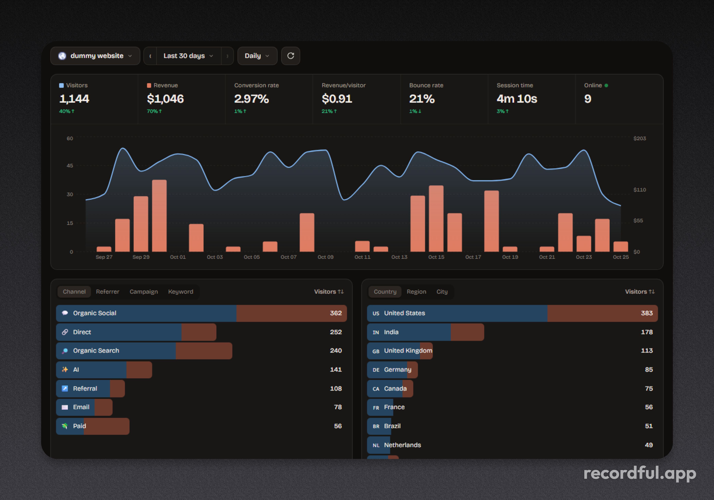

# Pixelmoth

<p align="center">
  
</p>

**Web analytics that follows the money.**

Most dashboards stop at "4,213 visitors". Pixelmoth keeps going: which tweet, article, search result or AI assistant sent them, what they did, and which source actually paid you.

It is self-hosted on Cloudflare Workers + D1: free to run for a side project, your data stays in your own account, and there is no central Pixelmoth service in the middle.

**Cloudflare Workers + D1 · 9 KB tracker (~3.5 KB gzipped) · React dashboard · Dodo Payments built in · MIT**

[Deploy](#deploy-your-own-copy-about-10-minutes) · [Install](#install-on-a-website) · [Revenue](#revenue-attribution) · [Local development](#local-development)

## What it does

- **Traffic:** channel, referrer, campaign, keyword, `ref` tag, entry page, country, browser, OS, device and hostname. Known sources (X, Google, ChatGPT, Claude, Reddit, Hacker News, Product Hunt and others) are grouped and labelled; unknown sources stay visible by domain or tag.
- **Behavior:** pageviews, entry pages, outbound clicks, button goals, ordered funnels, engaged time, bounce rate and visitors online now. Single-page apps are tracked automatically.
- **Revenue:** visitors, revenue net of refunds, conversion rate and revenue per visitor, each compared with the previous period. Visitors and revenue share one chart; customers and payments live in Journey.
- **Journey:** every customer with the source that earned them, amount, time to convert and match method. Open one to see the full timeline: visit → pages → clicks → payment.
- Click any row to filter the whole dashboard — "only visitors from the launch tweet" is one click. Ranges go from today to all time, with hourly, daily, weekly or monthly buckets. Multiple websites share one login, each with its own timezone and currency.

## Deploy your own copy (about 10 minutes)

Every copy is independent: your URL, your database, your password. You need a free [Cloudflare account](https://dash.cloudflare.com/sign-up), [Node.js 20+](https://nodejs.org) and Git.

### 1. Get the code

```bash
git clone https://github.com/iKislay/pixelmoth.git
cd pixelmoth
npm install
npx wrangler login          # opens your browser; click "Allow"
```

### 2. Create the database

```bash
npx wrangler d1 create pixelmoth
```

Keep the name `pixelmoth` — the npm scripts expect it. If Wrangler offers to add the database for you, answer **No**; answer **No** to the optional "Cloudflare skills" questions too.

Copy the printed `database_id` into `wrangler.jsonc`, replacing `00000000-0000-0000-0000-000000000000`. There must be exactly one entry under `d1_databases`, with `"binding": "DB"`.

### 3. Set the password and signing secret

```bash
npx wrangler secret put ADMIN_PASSWORD     # the password you will log in with
npx wrangler secret put SESSION_SECRET     # any long random string, e.g. openssl rand -hex 32
```

Typing is hidden. If Wrangler asks whether to create a Worker called `pixelmoth`, answer **Yes**.

### 4. Deploy

```bash
npm run deploy
```

This builds the dashboard, applies migrations and deploys the Worker. It prints your URL, usually `https://pixelmoth.<you>.workers.dev`.

Open it, log in, add a website and copy its script tag. The site's Settings page also has **Copy AI prompt**, which hands Claude Code, Cursor or another coding assistant the values it needs to install tracking for you.

If you see `fetch failed`, it is usually a VPN, proxy or Wi-Fi hiccup. Run `npm run deploy` again.

For a custom domain such as `analytics.yourdomain.com`, attach it in Cloudflare → Workers & Pages → pixelmoth → Settings → Domains & Routes.

### Updating later

```bash
git stash          # only if you edited database_id in wrangler.jsonc
git pull
git stash pop
npm run deploy
```

`npm run deploy` applies new migrations automatically.

### What the free plan covers

| Cloudflare free limit | What it means here |
| --- | --- |
| 100,000 Worker requests/day | Every tracked event, ping and dashboard API call counts. The dashboard files and `/js/script.js` are static and do not invoke the Worker. |
| 100,000 D1 rows written/day | A pageview writes a few rows (session update plus event), and engaged-time pings add more. Roughly 10–25k pageviews/day depending on session length. |
| 5M D1 rows read/day | A dashboard load reads several times the sessions in its range. Fine for side-project traffic. |
| 5 GB D1 storage | Years of events at this scale. |

At 5–10k visitors a month you will use a small fraction of this. Workers Paid starts at $5/month if you outgrow it.

## Install on a website

Put this in the `<head>` of every page, including checkout return pages such as `/thanks`:

```html
<script defer data-website-id="SITE_ID" src="https://YOUR-PIXELMOTH-HOST/js/script.js"></script>
```

Optional attributes: `data-api` to send events through a proxy, `data-domain` to force the cookie domain, and `data-allow-localhost` to track local development (localhost is ignored by default).

Track goals with attributes or JavaScript:

```html
<button data-pm-goal="signup_click">Get started</button>
<a href="/pricing" data-pm-goal="pricing_click" data-pm-goal-plan="pro">Pricing</a>
```

```js
window.pixelmoth('goal', 'signup_completed', { plan: 'pro' });
window.pixelmoth('identify', { user_id: '123', email: 'jane@acme.com', name: 'Jane' });
window.pixelmoth.attribution(); // { pm_visitor_id, pm_session_id }
```

- **Ignore your own visits:** open `https://yoursite.com/?pm_ignore=true` once per browser. Undo with `?pm_ignore=false`.
- **Subdomains** share a visitor because the cookie is set on the root domain.
- **Outbound clicks** are tracked automatically. Goals can also come from your backend; see [the API](#server-side-api).
- **Domain lock:** the Worker only accepts events for the configured domain and its subdomains.

### Tracking a specific tweet or article

X, Medium, LinkedIn and others hide the exact post behind a referrer like `t.co` or `medium.com`. Tag the link and the post gets its own row, with its own revenue:

```
https://yoursite.com/?utm_source=x&utm_medium=social&utm_campaign=launch-tweet
https://yoursite.com/?ref=launch-tweet            (short version; ?via= also works)
```

Settings has a link builder for this. For SEO, Google never reveals the search keyword, but **Entry page** filtered by the **Google** referrer tells you which article people found you through.

## Revenue attribution

Revenue comes from payments, not from goals or pageviews. A payment is credited to the visitor's **last visit that came from a real source** — the last non-direct touch. If someone sees the launch tweet, returns directly 17 days later and pays, the tweet gets the credit.

When the buyer is not obvious, Pixelmoth tries the most reliable signal first:

1. **Metadata:** `pm_visitor_id` and `pm_session_id` passed into the checkout.
2. **Return page:** the buyer lands on your return URL with `?payment_id=` or `?subscription_id=`.
3. **Customer:** the same customer paid before — used for renewals and repeat purchases.
4. **Email:** the payment email matches a visitor you called `identify()` on.
5. **Timing:** exactly one plausible checkout clicker before the payment.

Timing never guesses between several people. It accepts a single checkout click in the 3 hours before payment, a single buyer who came back to the site right after paying, or a single click in the last 30 minutes. The Journey tab shows how each payment was matched, and **Try matching again** re-runs the process for older payments.

Refunds are stored as negative amounts and subtract from revenue. Renewals do not inflate the customer count.

### Dodo Payments (built in)

1. In Dodo → Developer → Webhooks, add `https://YOUR-HOST/api/webhooks/dodo/SITE_ID` and subscribe to `payment.succeeded` and `refund.succeeded`. Paste the signing secret (`whsec_…`) into the site settings.
2. Pass the visitor cookies as metadata when creating a checkout on your server:

```ts
import { cookies } from 'next/headers';

const jar = await cookies();
await dodo.checkoutSessions.create({
  product_cart: [{ product_id: 'pdt_xxx', quantity: 1 }],
  return_url: 'https://yoursite.com/thanks',
  metadata: {
    pm_visitor_id: jar.get('pm_vid')?.value ?? '',
    pm_session_id: jar.get('pm_sid')?.value ?? '',
  },
});
```

3. **Recommended:** set the checkout's return/redirect URL to a page on your site that loads the script. Dodo appends `?payment_id=…` (or `?subscription_id=…`), which links the payment even when metadata is missing. Keep those parameters on the URL.

Using Dodo **payment links**? The script adds `metadata_pm_visitor_id` and `metadata_pm_session_id` to `checkout.dodopayments.com` links automatically. That metadata does not always reach the payment, so the return URL is still the reliable fallback.

Webhook signatures use the Standard Webhooks scheme; other event types are acknowledged so Dodo does not retry them.

### Server-side API

Send payments from any provider (Stripe, Paddle, Lemon Squeezy, PayPal, custom billing) and goals from your backend, using the site's API key from Settings:

```bash
curl -X POST https://YOUR-HOST/api/v1/payments \
  -H "Authorization: Bearer pm_..." \
  -H "Content-Type: application/json" \
  -d '{"transaction_id":"txn_1","amount":29.99,"currency":"USD","visitor_id":"<pm_vid cookie>","email":"jane@acme.com"}'

curl -X POST https://YOUR-HOST/api/v1/goals \
  -H "Authorization: Bearer pm_..." \
  -H "Content-Type: application/json" \
  -d '{"visitor_id":"<pm_vid cookie>","name":"signup"}'
```

`amount` is in major units (`29.99`, not `2999`). Payments also accept `session_id`, `customer_id`, `name`, an ISO `timestamp`, `renewal: true` and `refunded: true`. Payments use the same attribution rules as Dodo; goals attach to the visitor's latest session.

## Accuracy and privacy

No analytics tool is perfect. These are the real gaps:

- **Ad blockers** block some analytics domains. Proxy `/js/script.js` and `/api/event` through your own domain to recover most of them; Settings shows a Next.js rewrite example. Payments are still recorded by the webhook even when the browser blocked tracking.
- **Safari** limits JavaScript cookies to about 7 days. A Safari visitor who returns after a week looks new. Calling `identify()` helps recover payment attribution by email.
- **Bots** are filtered by user agent and the `navigator.webdriver` flag.
- **Currency:** payments in another currency use Dodo's settlement amount when it is in your site's currency. Otherwise no exchange-rate conversion is applied.
- **Location** comes from Cloudflare edge headers, or from Vercel's geo headers when proxied through Vercel.
- **Privacy:** no raw IP addresses are stored. Sensitive URL parameters (email, tokens, keys, passwords) are removed in the browser before sending. Cookies are first-party and shared across your subdomains.
- **Consent** is your responsibility. Review the cookie and privacy rules for your jurisdiction.

The dashboard login uses a signed 30-day cookie and locks an IP out for 15 minutes after 10 wrong passwords.

## Before you launch

Use strong secrets and your own HTTPS domain. Put the script on every page and subdomain, including checkout return pages, and proxy it through your domain to reduce ad-blocker loss. Call `identify()` after login, pass the visitor cookies in checkout metadata, set a return URL for every payment, and exclude your team with `?pm_ignore=true`. Then run `npm run typecheck && npm test && npm run smoke`.

## Local development

```bash
cp .dev.vars.example .dev.vars        # Windows PowerShell: Copy-Item .dev.vars.example .dev.vars
# edit .dev.vars and set ADMIN_PASSWORD + SESSION_SECRET

npm run db:migrate:local
npm run build                         # creates dist/ for the dashboard and tracker
npm run dev:api                       # http://127.0.0.1:8787

npm run dev:web                       # optional: hot-reloading dashboard on localhost:5173
npm run dev                           # API + hot-reloading dashboard together
npm run seed                          # optional: 35 days of demo data (the "dummy website" site)
npm test                              # unit tests
npm run smoke                         # end-to-end test against a running dev server
```

Log in with `ADMIN_PASSWORD` from `.dev.vars`. If `localhost` fails, use `127.0.0.1`. The smoke test reads `ADMIN_PASSWORD` from your environment (default `change-me`), needs the dev server running, and creates and deletes a `smoke-test.com` site, so it is safe to repeat.

## How it is built

- `static/js/script.js` — the tracker: cookies, pageviews, engaged time, goals, outbound clicks, Dodo link tagging and sensitive-parameter stripping.
- `src/server/` and `src/shared/` — a Hono app on Cloudflare Workers for ingestion, auth, D1 stats, Dodo webhooks, payments, goals and source classification.
- `src/web/` — the React dashboard. `db/migrations/` holds the schema; `tools/` has demo data and the smoke test.

The Worker only runs for `/api/*`; the dashboard and tracking script are static assets.

## Contributing

Issues and pull requests are welcome. Before opening a PR, run `npm run typecheck && npm test`.

## License

[MIT](LICENSE) — free to use, modify and self-host, including commercially.
